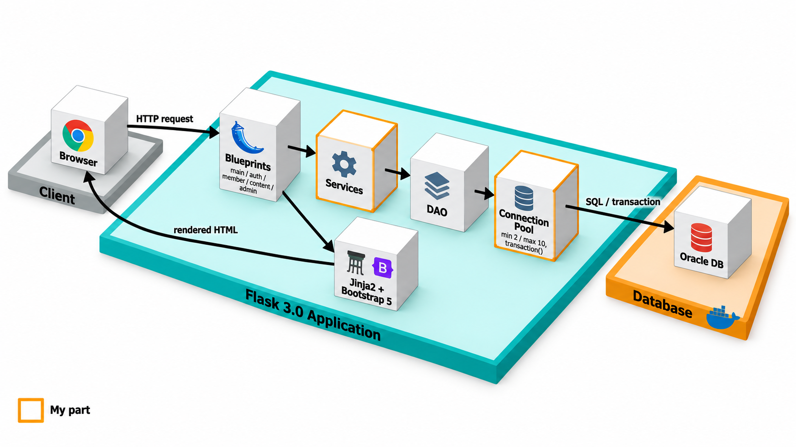
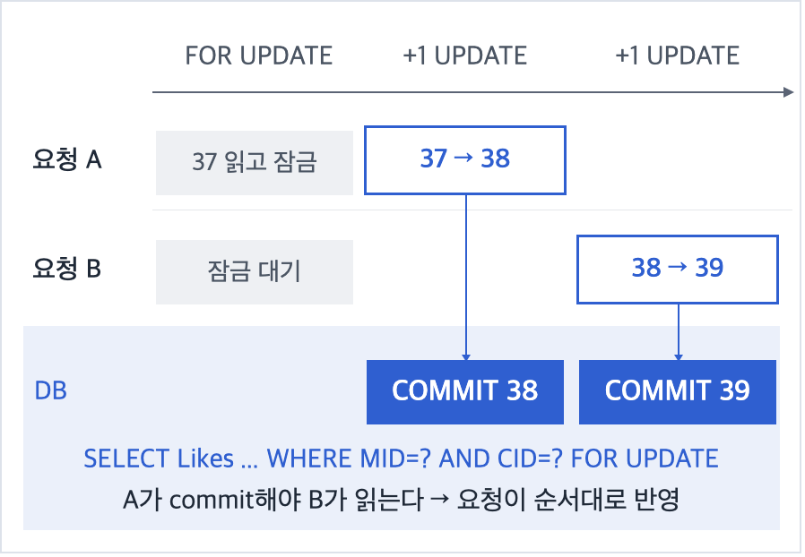
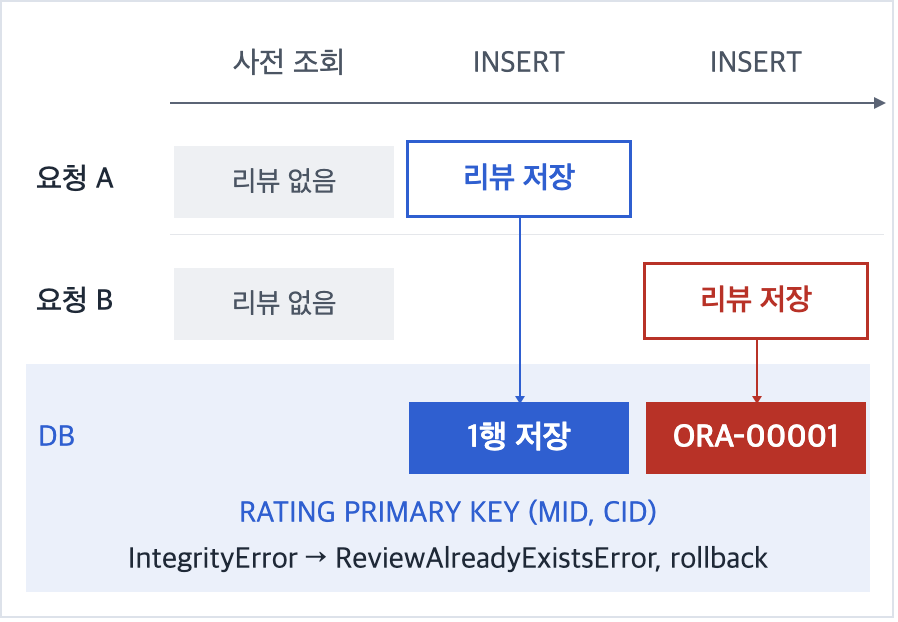

# 🎬 Metacritic 2.0

**영화·게임·도서 리뷰 웹 서비스(Flask · Oracle)에서 회원 인증과 리뷰 동시성 제어를 구현한 프로젝트입니다.**
동시 요청 20건 실험에서 좋아요 유실 0건(잠금 없을 때 7건 유실), 중복 리뷰 19건 차단을 확인했습니다.

## 👤 담당 역할 및 주요 구현

| 구분 | 구현 내용 | 위치 |
| --- | --- | --- |
| 인증·회원 | 세션 기반 로그인·로그아웃, 회원가입, 회원정보 조회·수정 | `auth_bp`, `member_service`, `member_dao` |
| 트랜잭션 | `db.transaction()` 컨텍스트 매니저로 정상 시 commit, 예외 시 rollback | `app/db.py` |
| 좋아요 동시성 | `SELECT ... FOR UPDATE` 행 잠금으로 Lost Update 방지 | `review_service.like_review` |
| 중복 리뷰 방지 | 사전 조회 + PK `(MID, CID)` + `ORA-00001` 예외 변환 | `review_service.create_review` |

## 🏗️ 시스템 아키텍처

트랜잭션 경계를 서비스 계층에 두어 하나의 비즈니스 동작이 하나의 트랜잭션이 되도록 했습니다. 계층별 상세는 [아키텍처 문서](docs/ARCHITECTURE.md)에 있습니다.

## 🔧 트러블슈팅

### 1. 좋아요 동시 요청 시 Lost Update

- **문제**: 좋아요는 `Likes`를 읽고 +1해 저장합니다. 두 요청이 같은 값을 읽으면 둘 다 같은 값을 저장해 한 건이 사라집니다.
- **선택**: `SELECT ... FOR UPDATE`로 대상 리뷰 행만 잠그고, 읽기·증가·저장을 한 트랜잭션(`db.transaction()`)에서 처리했습니다. 뒤 요청은 앞 요청이 commit한 값을 읽습니다.
- **검토한 대안**: 단일 `UPDATE ... SET Likes = Likes + 1`은 간단하지만, 이후 "자기 리뷰에는 좋아요 불가" 같은 검증을 넣으려면 읽기 → 판단 → 쓰기 구조가 필요합니다. 낙관적 잠금은 버전 컬럼 추가와 재시도 로직이 필요해, 같은 행에 요청이 몰리는 카운터에는 행 잠금이 더 단순하다고 판단했습니다.

  

- **검증**: 동시 20건에서 37 → 57로 유실 0건이었습니다. 같은 조건에서 잠금 없이 읽고 +1하면 37 → 50으로 7건이 유실됐습니다.

### 2. 리뷰 중복 등록

- **문제**: "이미 썼는지 조회 → INSERT" 사이에 다른 요청이 끼어들면, 두 요청 모두 조회를 통과해 같은 리뷰가 두 번 저장될 수 있습니다.
- **선택**: 사전 조회로 일반적인 중복을 안내하고, 동시에 통과한 요청은 PK `(MID, CID)` 위반(`ORA-00001`)으로 막았습니다. 이 예외를 `ReviewAlreadyExistsError`로 바꿔 같은 메시지를 보여주고 rollback합니다. PK 구조는 [ERD](docs/ERD.md)에 있습니다.

  

- **검증**: 동시 20건에서 성공 1건, 중복 오류 19건이었고 저장된 행은 1개였습니다.

### 3. 동시 요청 20건 실험

| 항목 | 방식 | 결과 | 조건 / 출처 |
| --- | --- | --- | --- |
| 좋아요 | `FOR UPDATE` (실제 코드) | 37 → 57, **유실 0건** | 동시 20건, 1회 / `like_review` |
| 좋아요 | 잠금 없음 (비교용) | 37 → 50, **유실 7건** | 동시 20건, 1회 / 측정 스크립트 내 별도 코드 |
| 중복 등록 | 사전 조회 + PK + 예외 변환 | **성공 1건, 차단 19건**, 저장 1행 | 동시 20건, 1회 / `create_review` |

공통 조건: Oracle 23ai Free(Docker, 프로젝트 문서는 21c), Python 3.12.9, 스레드 20개를 Barrier로 동시 출발, 커넥션 풀 min 2 / max 10, 2026-10-22에 측정했습니다. 서비스 함수를 직접 호출했으며 HTTP 레벨 측정은 아닙니다.

### 내가 틀렸던 순간

좋아요 첫 구현은 리뷰를 `rating_id` 하나로 찾도록 짰지만, `RATING`에는 단일 ID가 없고 PK가 `(MID, CID)`였습니다. 스키마를 다시 확인하고 잠금 대상을 "리뷰 작성자 + 콘텐츠" 조합으로 바꿨습니다. 같은 초안에서 중복 리뷰를 막으려면 UNIQUE 제약이 따로 필요하다고 적었지만, 실제로는 복합 PK가 이미 그 역할을 하고 있었습니다.

## 🔍 한계와 개선 방향

| 한계 | 개선 방향 |
| --- | --- |
| 비밀번호 평문 저장·비교 (`Password VARCHAR(16)`) | bcrypt 등 해시 저장, 컬럼 확장 |
| 좋아요 사용자를 기록하지 않아 한 사용자의 중복 좋아요를 막지 못함 | 좋아요 테이블 추가, PK로 차단 |
| 실험 1회, 서비스 함수 직접 호출 | 반복 측정, HTTP 부하 테스트 |

## 📋 프로젝트 정보

| 항목 | 내용 |
| --- | --- |
| 과목 | 경북대학교 데이터베이스 팀 프로젝트 (Phase 4) |
| 기간 | 2025.09 ~ 2025.12 |
| 원본 레포 | [db-project-13/project](https://github.com/db-project-13/project) |
| 시연 영상 | [YouTube](https://youtu.be/upL7zM2E1g4) |
| 원본 README | [팀 README](https://github.com/db-project-13/project#readme) (전체 기능 목록, 실행 방법) · [이 레포 보존본](docs/SETUP.md) |

| 구성원 | 담당 |
| --- | --- |
| **이태호** | **로그인, 회원정보 조회·수정, 동시성 제어** |
| 권용재 | 메인, 상세, 콘텐츠 창, 리뷰 등록 |
| 이시욱 | 콘텐츠 등록, 제작사, 태그, 시리즈 등록·수정 |

## 🛠️ 기술 스택

| 영역 | 기술 |
| --- | --- |
| Backend | Python, Flask 3.0.0 |
| Frontend | Jinja2, Bootstrap 5, JavaScript |
| Database | Oracle Database 21c, oracledb 3.4.0 |
| 협업 | GitHub (feature → develop → main PR 병합) |
